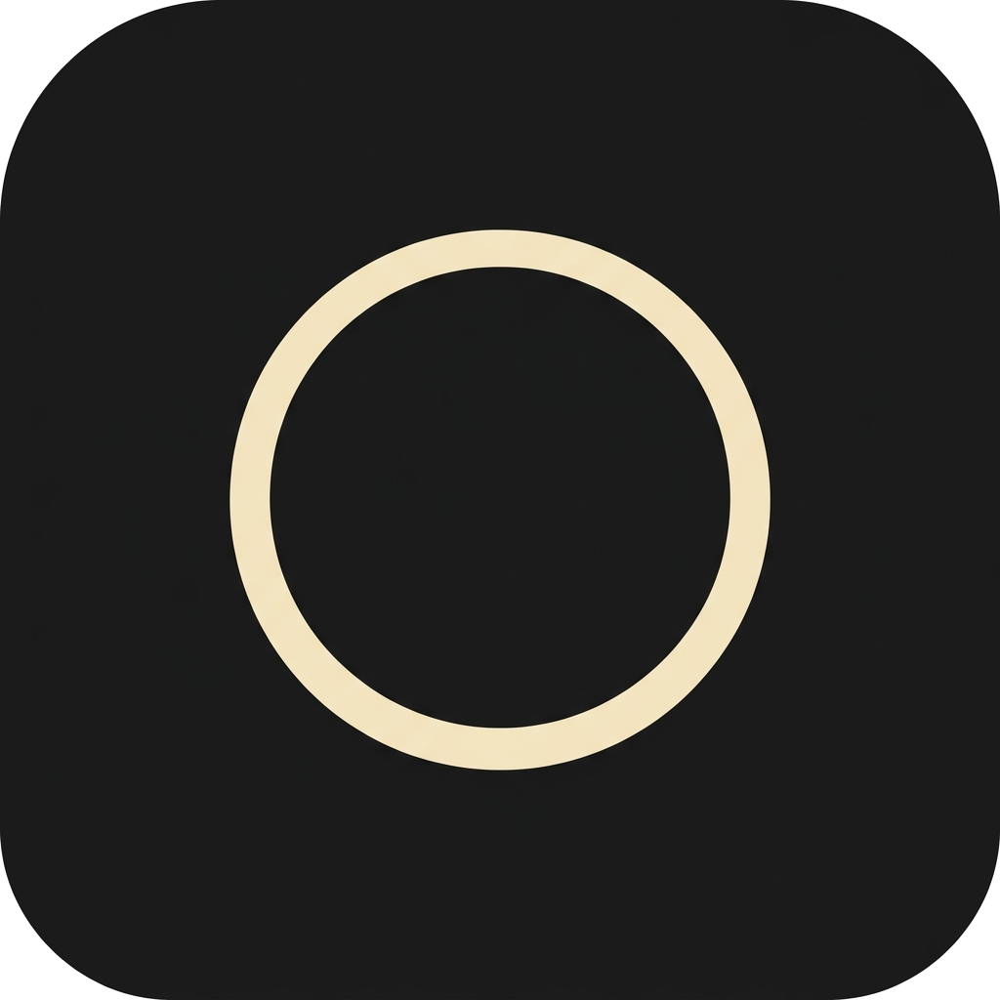

<div align="center">
  

  <h1>The Zeroth Docs</h1>

  <p>
    <strong>The One Desktop 的公开双语文档仓库。</strong>
  </p>

  <p>
    <a href="./README.md">English</a>
    |
    <strong>简体中文</strong>
  </p>

  <p>
    <a href="https://the-zeroth.com">官网</a>
    |
    <a href="https://github.com/the-zeroth/the-zeroth-docs/releases">发布记录</a>
  </p>
</div>

---

## 仓库作用

这个仓库用于维护 The Zeroth 官网使用的 The One Desktop 公开双语文档。

这里存放的是面向用户的文档内容、发布记录、截图和演示视频资源，不存放产品源码、私有基础设施、内部实现细节、密钥或部署专用配置。

## 文档结构

正式文档位于 `content/docs/zh` 和 `content/docs/en`。两种语言使用相同 slug，站点可以基于同一路由结构做语言切换。

```text
content/docs
+-- zh/                              中文文档
|   +-- index.mdx                    欢迎
|   +-- start/                       快速入门、模型与价格、发布记录
|   |   `-- release-notes/           每条版本线一页
|   +-- the-one-app/                 使用 The One
|   |   +-- main-assistant.mdx …     主助手、事项、工作组、需要你、触发器、
|   |   |                            进化、行动记录、随身通道
|   |   +-- capabilities/            工作组模板、角色、技能与提示词、MCP、模型、
|   |   |                            插件、总图、定义空间、记忆
|   |   `-- settings/                设置、API 配置、所有运行、Linux 服务器
|   `-- multi-agent-architecture/    工程思想
|       +-- single-agent/            模型、工具、上下文、ReAct、行动链
|       +-- evolution/               从单一 Agent 到 Multi-Agent
|       +-- a-genetic-engineering/   模板即基因
|       +-- prolifera-engineering/   在运行时长出系统
|       `-- more-possibilities/      通讯、上下文编辑、Dynamic Graph、冥想
`-- en/                              English documentation, same slugs
```

## 草稿与资源

- `docs_md`：本地新文档草稿来源。该目录已被 Git 忽略。
- `resources`：早期 0.1.0 的演示视频，留作参考，没有页面引用。
- `public/docs-assets/images`：文档页面使用的截图资源。
- `public/docs-assets/videos`：文档页面使用的演示视频资源。

## 编辑方式

文档页面直接在 `content/docs/en` 与 `content/docs/zh` 中编写，两种语言需要一起更新。当前版本的截图放在 `public/docs-assets/images/<版本>/<语言>/`，用对应语言的界面截取。官网会从本仓库同步 `content/docs` 与 `public/docs-assets`。

曾用于从 `docs_md` 生成首版页面的 `scripts/migrate_docs_md.py` 已移除：它会先删除 `content/docs` 再重新生成，且早已与已发布的页面不一致。如有需要，可以在 Git 历史中找到它。

## 维护原则

- 中英文文档必须保持相同 slug，避免语言切换时路由漂移。
- 面向用户的表达放进 `content/docs`，原始草稿放进本地 `docs_md`。
- 截图和视频必须走 `public/docs-assets`，不要在页面里引用本地草稿路径。
- 不要在这个仓库提交产品源码、密钥、内部架构细节或部署专用配置。

## 内容边界

The One 是一款桌面应用：主助手接下每一个请求，交给在用户自己电脑上运行的 AI 智能体工作组去做。

这个仓库只负责公开文档表达。真正的桌面端实现、后端服务、账号系统、模型调用实现和内部编排逻辑都不在这里。
